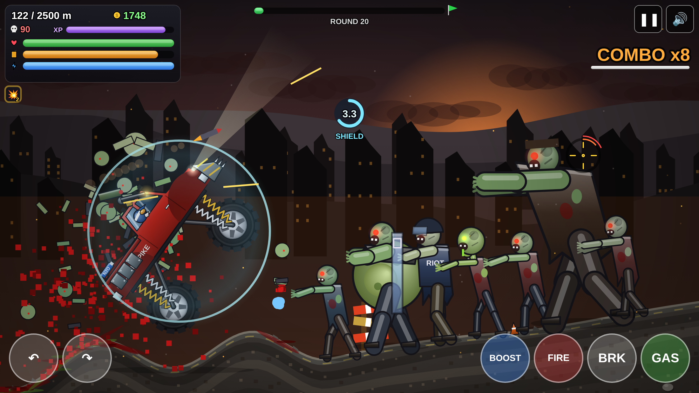
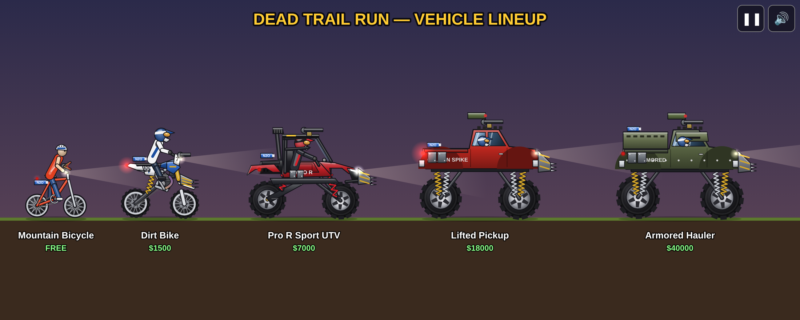
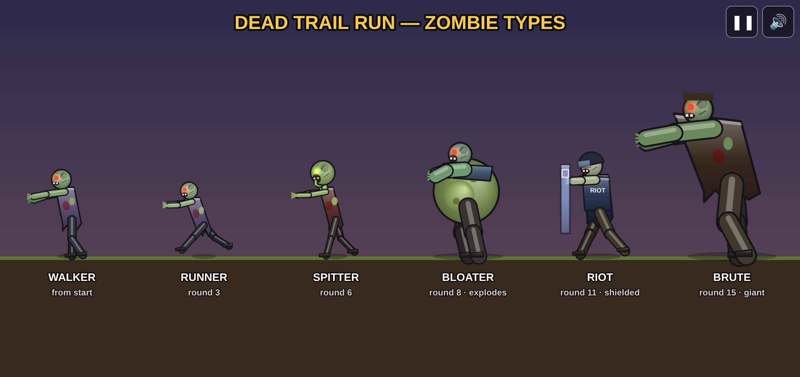
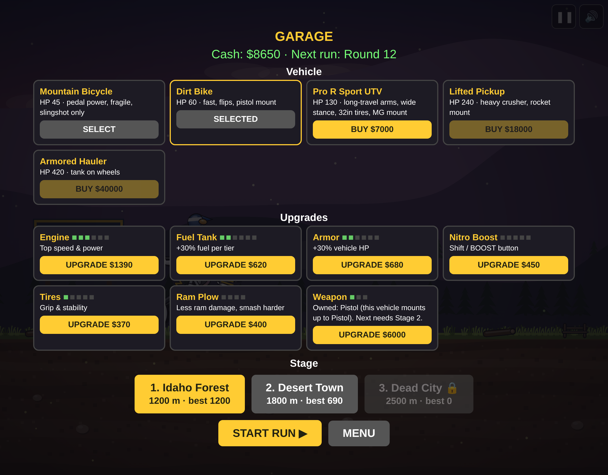

# Dead Trail Run

A 2D side-scrolling zombie-survival driving game in a single HTML file (canvas + JavaScript, no dependencies). Start at the Golden Spike Powersports sign in Ashton, Idaho, and fight your way to the evac point across three stages: Idaho Forest, Desert Town and Dead City. Earn cash, upgrade in the garage, and work up from a mountain bicycle to a dirt bike, a Pro R-style long-travel UTV, a lifted pickup and an armored hauler.

**Play:** https://jaywalker16.github.io/dead-trail-run/

## Controls
| Action | Keyboard / mouse | Touch |
|---|---|---|
| Gas / brake | W or ↑ / S or ↓ | GAS / BRK |
| Lean back / forward (flips) | A or ← / D or → | ↶ / ↷ |
| Aim | Move mouse | Drag on screen |
| Fire | Hold left mouse button (or F) | Hold FIRE |
| Nitro boost | Shift | BOOST |
| Pause / mute | P or Esc / M | on-screen buttons |

Complete a front or back flip to get 5 seconds of invincibility and a speed burst. Your progress is saved in the browser's localStorage. Add `?q=1` or `?q=0` to the URL to force a lower graphics quality; otherwise the quality drops automatically if frames run slow.

## License
MIT. All artwork is original vector code. "Pro R style" is descriptive only; no official logos are used.
